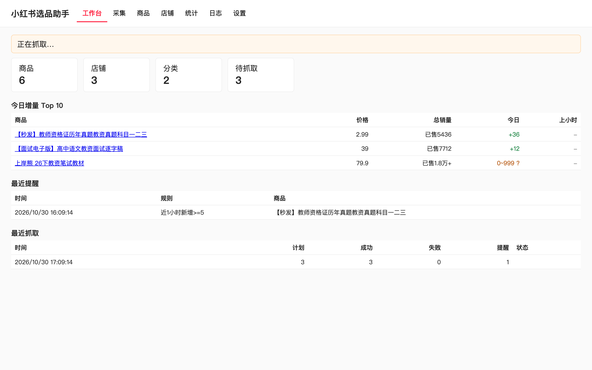
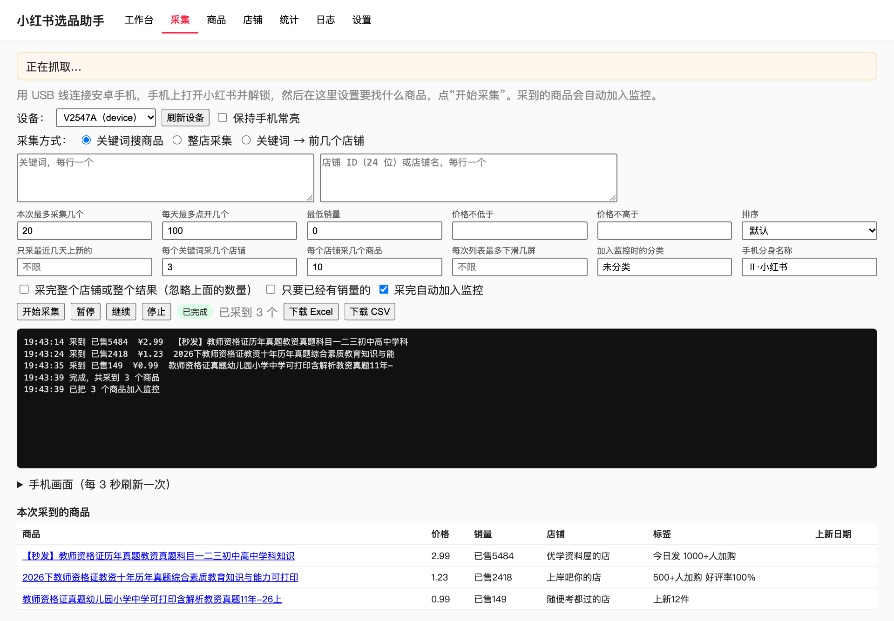
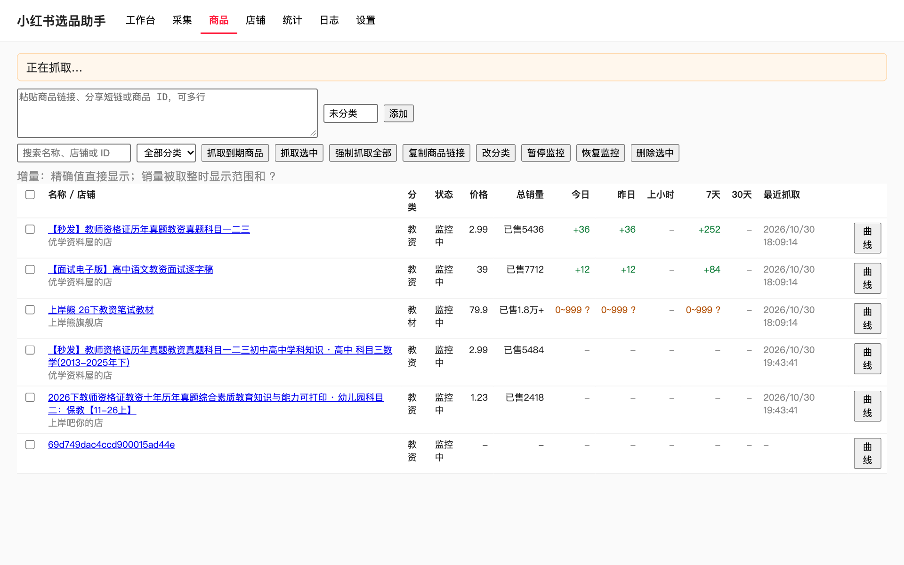
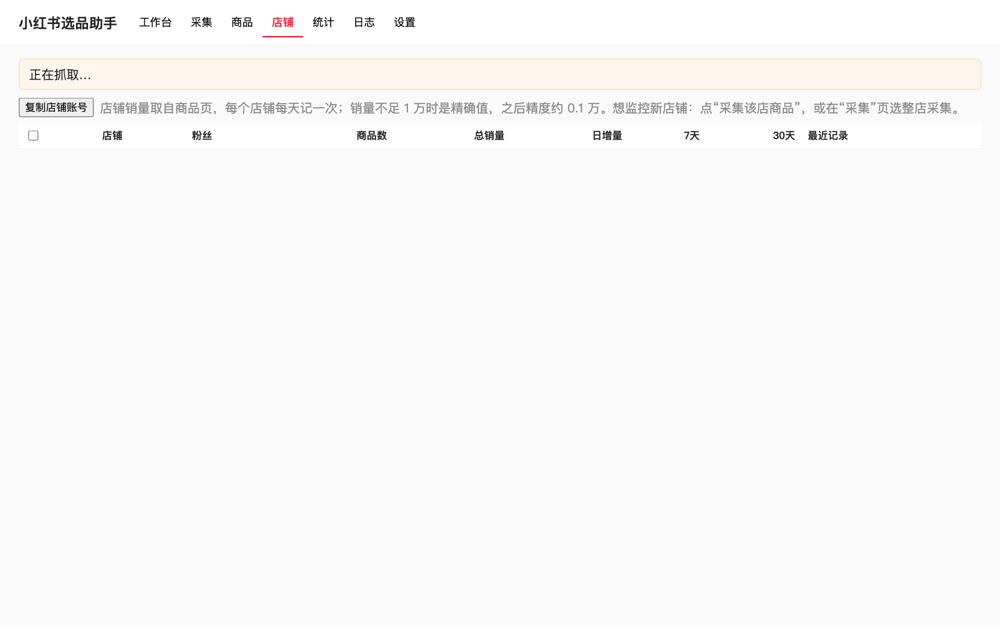
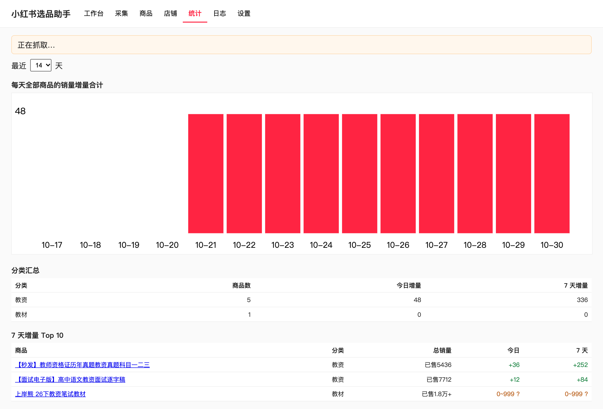
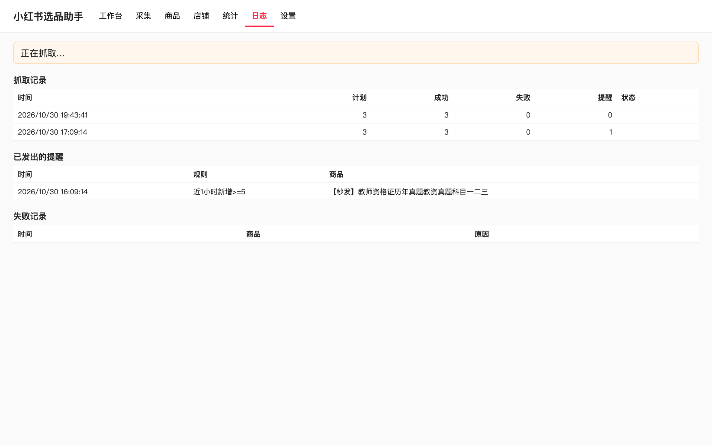
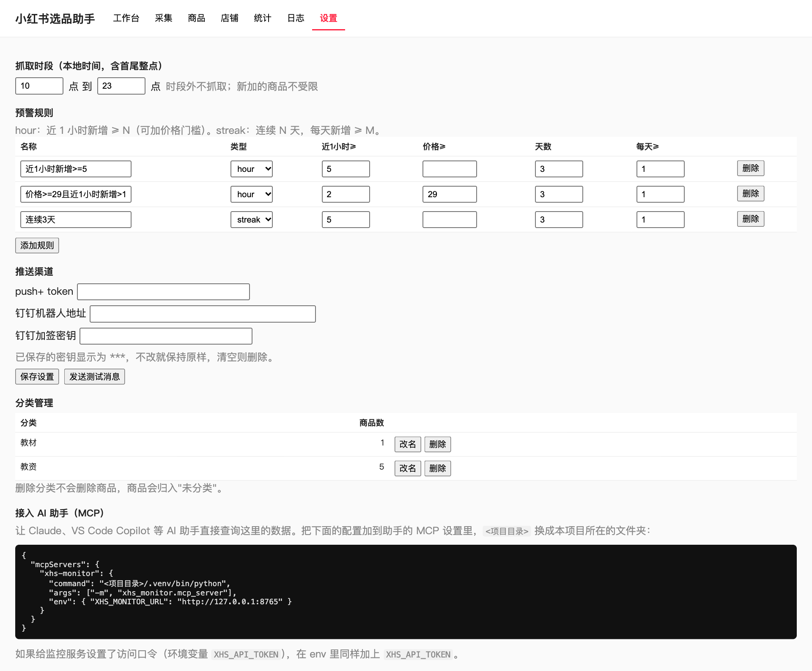

# 小红书选品系统 使用教程（面向非技术人员）

这套系统帮你做两件事：

1. **找商品**：让一部安卓手机自动在小红书里搜关键词、逛店铺，把商品记成表格（系统 1，“采集”）。
2. **盯销量**：每小时自动查这些商品的销量，算出新增多少，涨得快就给你发消息（系统 2，“监控”）。

两件事都在同一个网页里操作，不需要写代码。

> 先说清楚几件事：
> - 这是个人研究工具，请控制使用频率，遵守小红书平台规则。用于采集的账号有被限制的风险，**建议用小号**。
> - 采集到的商品信息仅供自己选品参考，不要转载、售卖或用于侵犯他人权益的用途。
> - 本教程里标了“未实测”的功能，代码已写好并通过自动测试，但没有在真实环境里跑过，请先小规模试用。

---

## 一、准备清单

| 需要的东西 | 说明 |
|---|---|
| 一台电脑 | **Mac 或 Windows 10/11 都可以**，要能上网。运行本系统。下文按系统分别说明，请只看自己电脑对应的部分 |
| Google Chrome 浏览器 | 系统用它来查商品销量，不需要登录 |
| 一部安卓手机 + 数据线 | 系统 1 用。已安装小红书并登录。**必须用数据线**连电脑（公司 VPN 下无线连接不可用） |
| 本项目文件夹 | 即 `xhs-selection-system` |

---

## 二、第一次安装（约需几分钟网络下载）

### 第 1 步：安装电脑上的软件

#### Mac

已经装过 Homebrew（Mac 上的软件安装工具）的跳过这一段。没装过的，打开“启动台 → 其它 → 终端”，粘贴下面这一行回车，按提示操作：

```
/bin/bash -c "$(curl -fsSL https://raw.githubusercontent.com/Homebrew/install/HEAD/install.sh)"
```

然后在项目文件夹里找到 **安装.command**，双击。它会自动安装 `uv`、`adb`（连手机用）和程序依赖。完成后出现“安装完成”。

> 如果提示“无法打开，因为来自身份不明的开发者”：右键点这个文件 → 打开 → 再点“打开”。只需要这一次。
> 如果提示“没有权限”：在终端里进入项目文件夹，执行 `chmod +x *.command`。

#### Windows

1. 先安装 Google Chrome（https://www.google.cn/chrome/），已经有的跳过。
2. 在项目文件夹里找到 **安装.bat**，双击。它会用 Windows 自带的 winget 自动安装 `uv`、`adb`（连手机用）和程序依赖。
3. 如果窗口提示“请关闭本窗口，再双击一次”，照做即可（刚装的软件要重开窗口才生效）。完成后出现“安装完成”。

> 如果 Windows 弹出“Windows 已保护你的电脑”：点“更多信息 → 仍要运行”。
> 如果连不上网络导致安装失败：检查公司代理或 VPN 后重试。
> Windows 版目前**没有在真实 Windows 电脑上测过**，如果遇到问题，请把窗口上的提示截图反馈。

### 第 2 步：设置手机（只做一次，Mac 和 Windows 一样）

1. 手机“设置 → 关于手机”，连续点“版本号”7 次，打开开发者模式。
2. “设置 → 系统管理（或更多设置）→ 开发者选项”，打开 **USB 调试**。
3. 用数据线连到电脑。手机弹出“是否允许 USB 调试”，勾选“始终允许”，点允许。Windows 用户如果电脑识别不到手机，需要先安装手机厂商的 USB 驱动（常见做法：装手机厂商的手机助手，或在设备管理器里更新驱动）。
4. 手机里登录小红书。
5. **如果手机有“应用分身”**（比如 vivo 的“Ⅱ·小红书”）：系统通过链接打开小红书时，手机会弹出一个“选择要使用的应用”。程序默认点名字叫 `Ⅱ·小红书` 的那个。如果你想用另一个（比如原版“小红书”），或者你的手机名字不一样，在网页“采集”页的“手机分身名称”里填你要点的那个名字。

检查是否连上：打开网页后（见下一节），“采集”页的设备栏能显示手机型号就是成功。

---

## 三、每天怎么用

### 启动

双击 **启动.command**（Windows 双击 **启动.bat**）。会弹出一个黑色窗口，几秒后浏览器自动打开系统页面（地址 `http://127.0.0.1:8765`）。

> **黑色窗口不要关**，关了监控就停了。要停止时，双击 **停止.command**（Windows 是 **停止.bat**），或关闭黑色窗口。
> 电脑合盖或休眠期间不会抓销量。Mac 的启动脚本会自动阻止闲置休眠（合盖仍会休眠）；Windows 请在“设置 → 系统 → 电源”里把“接通电源时，休眠”设为“从不”，并保持插电。

### 页面导览

网页上方有 7 个标签：



| 标签 | 作用 |
|---|---|
| 工作台 | 总览：商品数、今日销量增量排行 Top 10、最近的提醒和抓取情况 |
| 采集 | 系统 1。用手机找商品 |
| 商品 | 系统 2。你关注的商品清单和它们的销量变化 |
| 店铺 | 由商品自动得到的店铺，每天记录一次店铺总销量 |
| 统计 | 按天统计整体销量变化 |
| 日志 | 抓取记录、已发出的提醒、失败原因 |
| 设置 | 提醒规则、推送方式、分类管理 |

---

## 四、系统 1：用手机找商品

进入 **采集** 标签。



### 开始前

- 手机用数据线连着电脑，**屏幕保持解锁**（系统会自动让手机一直亮屏，结束后恢复原设置）。
- 采集期间**不要操作手机**，否则会被打断。

### 三种找法

| 模式 | 适合 | 怎么填 |
|---|---|---|
| 关键词搜商品 | 想找某一类商品 | 填关键词（一行一个），例如 `教师资格证真题` |
| 整店采集 | 已经知道某家店 | 填店铺 ID（24 位）或店铺名称 |
| 关键词 → 前几个店铺 | 想顺着关键词找到好店，再采这些店里的商品 | 填关键词，再设“每个关键词采几个店铺”“每个店铺采几个商品” |

### 常用设置

- **本次最多采集几个**：建议先填 3 到 5 个试一次。
- **最低销量**：销量低于这个数的商品直接跳过，省时间。
- **加入监控时的分类**：采到的商品会放进这个分类，方便以后筛选，例如“教资”。
- **采完自动加入监控**：打勾后，采到的商品会直接进入“盯销量”。
- **排序**：默认 / 销量 / 新品 / 价格 / 综合。
- **只采最近几天上新的**：整店采集时用来发现新品。
- **只要已经有销量的**：跳过还没卖出过的商品。
- 程序内置每天最多点开 100 个商品的上限，防止操作过多。

点 **开始采集**，下面的日志会一行一行显示进度，结果表格实时增加。你可以随时点：

- **暂停 / 继续**：中途想用手机时先暂停。
- **停止**：马上结束，已采到的会保存。

采完后可以点 **下载 Excel** 或 **下载 CSV**。表格里有：商品 ID、标题、价格、销量、店铺名称、店铺销量、上新日期、店铺 ID、采集时间等。

### 重要提醒

- 如果小红书弹出“验证”或风控提示，系统会**立即停止并截图**，请换个时间再试，不要反复硬来。
- 手机前台被别的 App 占着、手机锁屏、数据线松了，都会导致“等待超时”。解锁手机、回到桌面后重新开始即可（已看过的商品会自动跳过，相当于断点续采）。
- 一次采得太多会增加被限制的风险，建议少量多次。

---

## 五、系统 2：盯销量

### 加入商品

进入 **商品** 标签：



- 把商品链接、分享短链或商品 ID 粘贴进去（可以一次粘贴很多，混着也行），点添加。
- 采集页打了勾的话，采到的商品已经自动在这里了。

### 看什么

- **今日 / 昨日 / 上小时 / 7 天 / 30 天** 的销量增量，点表头可以排序。
- 数字后面带 `?` 表示小红书把销量显示成了“1.8万+”这种取整值，增量只是最少值（下界），不是精确数。
- 点“曲线”可以看这个商品的历史折线。
- 可以多选后批量：改分类、暂停、恢复、删除、立即抓取。

### 它是怎么抓的

- 每小时抓一次每个商品。默认只在 10:00 到 23:59 之间抓（可在设置里改）。
- 电脑休眠错过的整点，醒来后会自动补上。
- 遇到网页要求验证或限流，系统会**暂停 6 小时并通知你**，在页面上可以手动恢复。

### 店铺和统计



- **店铺**页：每个店铺每天记一次总销量，并显示日、7 天、30 天增量。店铺行上可以点“采集该店商品”，直接转到采集页。
- **统计**页：



### 日志



出了问题先看这里：哪个商品抓取失败、为什么失败、发过哪些提醒。

---

## 六、设置：提醒规则和消息推送



### 预警规则

系统自带两条：

1. 近 1 小时新增销量 ≥ 5
2. 商品价格 ≥ 29 元，并且近 1 小时新增 > 1

你可以增加“连续 N 天，每天新增 ≥ M”这类规则，找持续稳定上升的商品。同一个商品同一条规则不会重复提醒（1 小时规则间隔 3 小时，连续规则间隔 20 小时）。

### 接收提醒

支持两种方式，填一种或两种都行：

**push+（微信）**
1. 打开 pushplus 网站，微信扫码登录，拿到你的 token。
2. 粘贴到设置页的 “push+ token”，保存。

**钉钉群机器人**
1. 钉钉群 → 群设置 → 机器人 → 添加自定义机器人，安全设置选“加签”。
2. 把得到的 Webhook 地址和加签密钥分别粘贴到设置页，保存。

填好后点 **发送测试消息**，手机或钉钉收到就算成功。

> push+ 和钉钉的真实发送**未实测**（代码路径有自动测试），请务必先发一次测试消息确认。

### 设置里的其它项

- **抓取时段**：几点到几点才抓。
- **分类管理**：给分类改名或删除。

---

## 七、开机自动运行（可选）

不想每次手动启动，可以让它随电脑登录自动运行。

**Mac**：在终端里进入项目文件夹，执行：

```
deploy/launchd.sh install
```

查看状态用 `deploy/launchd.sh status`，取消用 `deploy/launchd.sh uninstall`。这个功能只做了语法检查，**未实测**，如果出问题，用 uninstall 取消，改回双击“启动.command”。

**Windows**：按 `Win + R`，输入 `shell:startup` 回车，会打开“启动”文件夹。把 **启动.bat** 的快捷方式（右键 → 创建快捷方式）放进去即可，下次登录自动运行，会同时打开浏览器页面。不想自启时把快捷方式删掉即可。未实测。

---

## 八、给 AI 助手用（可选，MCP）

如果你用支持 MCP 的 AI 工具（例如 VS Code 里的 Copilot 或 Claude），可以让 AI 直接帮你查商品销量、看提醒、添加商品。设置页的“接入 AI 助手（MCP）”一节有一段现成的配置，复制到 AI 工具的 MCP 配置里即可。不需要的话可以完全忽略。

如果给网页设置了访问密码（环境变量 `XHS_API_TOKEN`），网页会在第一次打开时要求输入，MCP 配置里也要带上同一个值。只在本机使用不需要设置。

---

## 九、常见问题

**Q：网页打不开？**
黑色窗口是否还开着？没有的话重新双击“启动.command”。

**Q：采集页看不到手机？**
换根数据线（要能传数据的），手机上点“允许 USB 调试”；仍不行就拔掉重插。

**Q：采集时提示“等待超时”？**
通常是手机被锁屏、前台是别的 App，或者弹出了没处理的窗口。先回到手机桌面并解锁，再点开始。错误提示里会写出手机当前前台是哪个 App，并附一张截图（保存在 `data/collector/` 文件夹）。

**Q：提示“应用选择框里没有 XXX”？**
手机弹出的“选择要使用的应用”里没有你填的分身名称。在采集页“手机分身名称”里改成手机上实际显示的名称。

**Q：销量增量总是带问号？**
小红书对超过一定数量的销量只显示取整数（如 1.8 万+），算不出精确增量，只能给出下限。这是数据本身的限制。

**Q：怎么把手机恢复成原来的息屏设置？**
正常结束采集后会自动恢复。如果程序被强行关闭，在终端（Windows 用 PowerShell）项目文件夹里执行：
`uv run python -m xhs_collector awake off`

**Q：Windows 上双击脚本一闪而过？**
在项目文件夹的地址栏输入 `cmd` 回车，打开黑色窗口后输入脚本名（如 `启动.bat`）再回车，就能看到报错信息。

**Q：Windows 上提示找不到 adb？**
关闭所有黑色窗口重新打开再试；仍不行就在黑色窗口里执行 `winget install Google.PlatformTools`。

**Q：数据存在哪里？**
`data/monitor.db`（销量历史，不要删），`data/collector/`（采集结果表格和截图）。备份时复制 `data` 文件夹即可。

---

## 十、已知限制（请知悉）

- 采集只在一部 vivo V2547A 手机、小红书 9.51.0 上调试过。App 改版后，界面文字变了可能就找不到按钮。
- 运行系统方面：Mac 已实际跑通；Windows 版（安装/启动/停止 .bat 脚本、adb 编码处理）只做了代码层面的适配，**没有在真实 Windows 电脑上测过**。
- 没有测过连续采集几百个商品是否会触发验证；没有测过每小时监控几千个商品的性能。
- “上新日期”只验证过“今天”这一组。
- 没有手机投屏功能，采集页只提供手机屏幕截图预览。
- 采集页不显示店铺粉丝数（监控的店铺页有）。
- 店铺销量 1 万以下是精确值，1 万以上取整到 0.1 万。
- 采集用的小红书账号如果被限制，请换号，不要继续高频使用。

---

## 附：命令行用法（进阶）

不想点网页的话，也可以用命令行，详见项目根目录的 `README.md`。例如：

```
uv run python -m xhs_collector search "教师资格证真题" --limit 20 --xlsx --push http://127.0.0.1:8765 --category 教资
uv run python -m xhs_collector keyword-shops "教资" --shops 3 --per-shop 10
```
